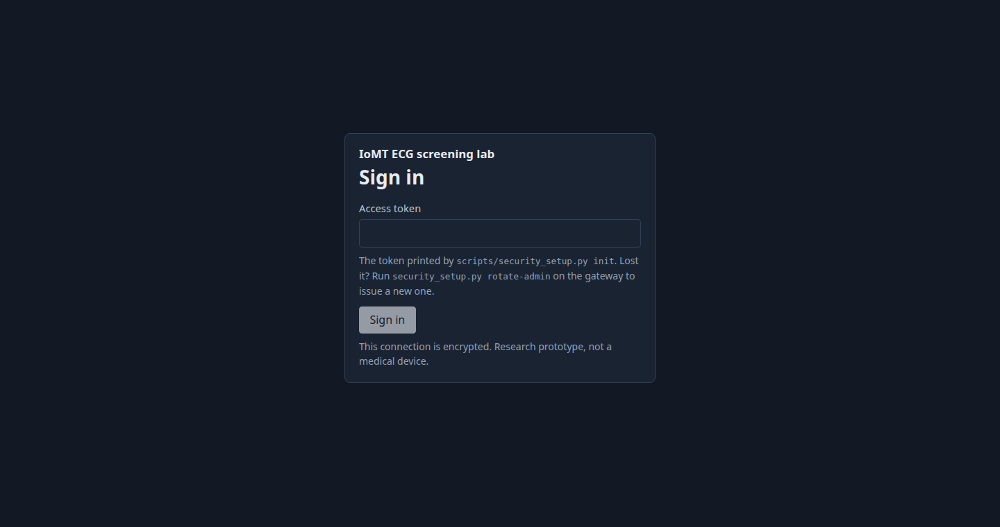
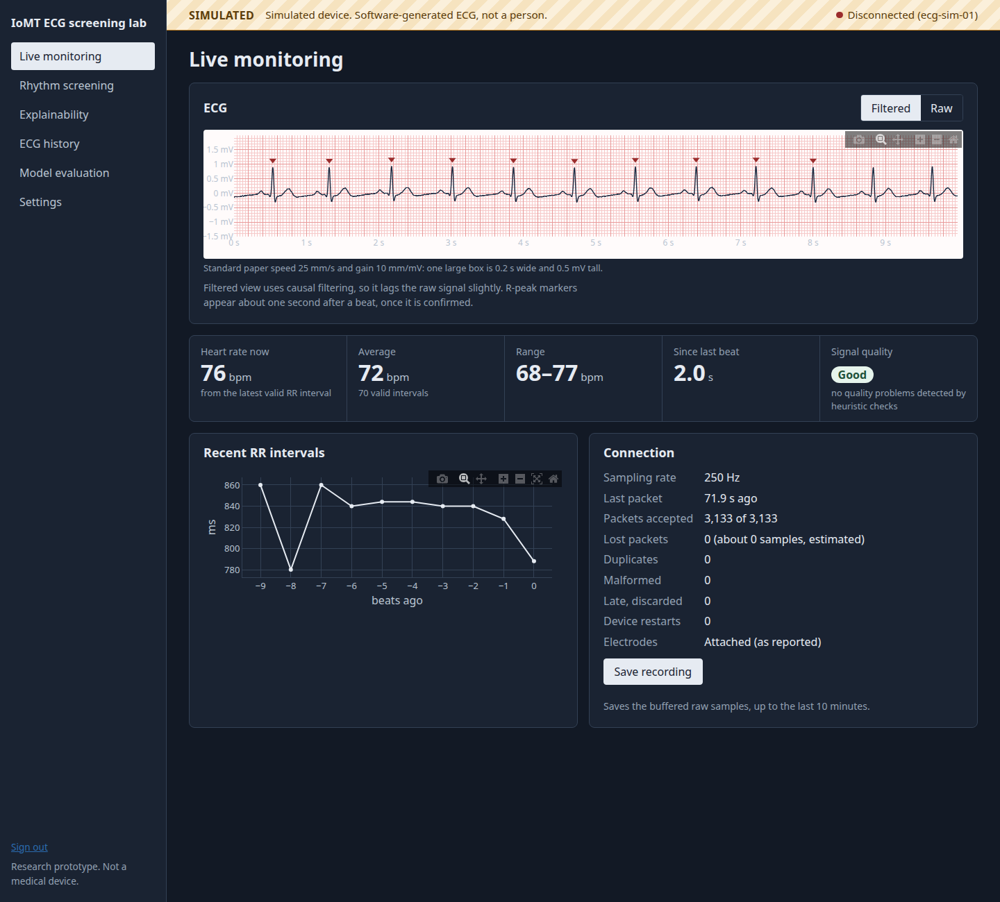

# Explainable Edge AI for Low-Cost ECG Screening: an IoMT prototype (ESP32 + AD8232)

A research prototype of an **Internet of Medical Things (IoMT)** ECG system. An AD8232
sensor on an ESP32 streams ECG over encrypted, authenticated Wi-Fi to a laptop gateway.
The gateway filters the signal, detects heartbeats, measures heart rate and HRV, screens
for selected rhythm abnormalities, and explains each screening result on a signed-in
dashboard.

How the layers fit together is in [docs/architecture.md](docs/architecture.md), and how
each channel is secured is in [docs/security.md](docs/security.md).

> **Research use only. Not a medical device.** Screening flags are preliminary signals,
> not diagnoses. Read [docs/safety.md](docs/safety.md) before connecting anything to a
> person.

## What is in the box

| Part | Where | Status |
|---|---|---|
| ESP32 firmware (sampling task, bounded queue, WebSocket over TLS, device token, reconnect) | `firmware/esp32_ecg_logger/` | Written and syntax-checked; **not compiled for the ESP32 or flashed** (no board here) |
| Software device simulator (same wire protocol, always labelled SIMULATED) | `src/ecg/simulator.py` | Tested |
| Signal processing: filters, quality, Pan–Tompkins, HR, RR, HRV | `src/ecg/` | Tested |
| Models A–E: rules, Random Forest, XGBoost, 1D-CNN, CNN + XGBoost | `src/ecg/ml/` | Trained and evaluated on MIT-BIH |
| Explanations: rule evidence, permutation importance, TreeSHAP, integrated gradients | `src/ecg/xai/` | Tested |
| FastAPI gateway with SQLite storage | `src/ecg/api/`, `src/ecg/storage.py` | Tested |
| Security: local CA, TLS, device tokens, signed-in dashboard sessions | `src/ecg/security.py`, `scripts/security_setup.py` | Tested |
| React dashboard (6 pages) | `web/` | Built; reviewed in headless Chrome |

## Dashboard at a glance

| Sign-in | Live monitoring |
|---|---|
|  |  |

Each page is described with its screenshot in [docs/dashboard.md](docs/dashboard.md).

## Setup

Requirements: Python 3.11+ and Node 18+. A GPU is not needed.

```bash
uv venv --python 3.12 .venv                       # or: python -m venv .venv
uv pip install --python .venv/bin/python -e ".[dev,xgboost]"
# Optional, for the CNN models (CPU-only build):
uv pip install --python .venv/bin/python torch --index-url https://download.pytorch.org/whl/cpu

cd web && npm install && npm run build && cd ..
```

Without XGBoost or PyTorch the system still runs: rules and Random Forest work, and the
missing models are reported as unavailable.

## Run it

**1. Train the models (once).** This downloads MIT-BIH (about 100 MB) only because you
pass `--download`:

```bash
.venv/bin/python scripts/prepare_mitbih.py --download --mirror aws   # or the default physionet mirror
.venv/bin/python scripts/train_models.py                             # about 2 minutes on a laptop CPU
.venv/bin/python scripts/seed_variance.py                            # optional: run-to-run spread of CNN models
```

**2. Create security material (once).** This makes a local certificate authority, a
server certificate and the dashboard access token, then registers the simulator as a
device. Each token is printed once, so keep it.

```bash
.venv/bin/python scripts/security_setup.py init --host 127.0.0.1   # add --host <LAN address> for a real ESP32
.venv/bin/python scripts/security_setup.py add-device ecg-sim-01 --kind simulator
```

**3. Start the gateway** and sign in with the access token:

```bash
.venv/bin/python scripts/serve.py --tls                 # https://127.0.0.1:8000/ui/ (this computer only)
.venv/bin/python scripts/serve.py --host 0.0.0.0 --tls  # on the network, needed for a real ESP32
```

TLS is mandatory whenever the gateway listens on the network. Without `--tls`, it serves
plain HTTP on `127.0.0.1` only (http://127.0.0.1:8000/ui/), and sign-in is still required.
Browsers warn about the local CA until you import `secrets/ca.pem` as trusted.

**4. Feed it data**, in one of three clearly labelled modes:

| Mode | Command | Shown as |
|---|---|---|
| Simulated device | `ECG_DEVICE_TOKEN=<token> .venv/bin/python scripts/run_simulator.py --url wss://127.0.0.1:8000/ws/ingest --ca secrets/ca.pem` | **SIMULATED** (hatched amber band) |
| Real hardware | flash the firmware, see [docs/wiring.md](docs/wiring.md) | **LIVE** |
| Offline recording | `.venv/bin/python scripts/import_recording.py --mitdb 208 --minutes 5` or `--csv file.csv --fs 250` | **OFFLINE** (History page) |

The simulator can inject network faults to exercise the integrity checks:
`--fault-drop 0.01 --fault-duplicate 0.01 --fault-reorder 0.01`.

For frontend development with hot reload, run the gateway without `--tls`, run
`npm run dev` in `web/`, and open <http://127.0.0.1:5173/ui/>. The API is proxied over
loopback.

## Tests

```bash
.venv/bin/python -m pytest
```

Tests that need trained models are skipped until `scripts/train_models.py` has run.

## Results at a glance (held-out MIT-BIH patients)

All numbers are on DS2: 22 records whose patients never appear in training. Full details,
including per-class sensitivity and specificity, confusion matrices and caveats, are on the
dashboard's Model evaluation page and in [docs/model_card.md](docs/model_card.md).

- **R-peak detection** (causal, live settings): sensitivity 0.997, PPV 0.999 on DS2.
- **Beat classification** is reliable for ventricular beats (V) and weak for
  supraventricular (S) and fusion (F) beats, especially with the tree models. See the
  model card before relying on any beat-level output.
- Nothing measured on simulated data is reported as performance.

## Repository map

```
firmware/esp32_ecg_logger/   Arduino sketch and config template
src/ecg/
  config.py                  validated configuration (research parameters)
  security.py                tokens, device registry, sessions, login throttling
  ingest.py                  packet parsing, sequence gaps, duplicates, restarts
  pipeline.py                live processing on a gap-aware device timeline
  preprocess.py quality.py   filtering (causal and zero-phase) and signal quality
  rpeak.py hr.py hrv.py      Pan–Tompkins detection, RR flags, HR and HRV
  features.py                causal per-beat features (shared by training and inference)
  analysis.py                whole-recording offline analysis
  ml/                        rules, datasets, training, CNN, inference
  xai/                       importance, local explanations, reliability warnings
  api/                       FastAPI app and Pydantic schemas
  storage.py                 SQLite metadata and NumPy waveforms
scripts/                     data preparation, training, server, simulator, import, security setup
web/                         React + TypeScript + Plotly dashboard
docs/                        architecture, security, protocol, wiring, safety, model card
tests/                       pytest suite
```
