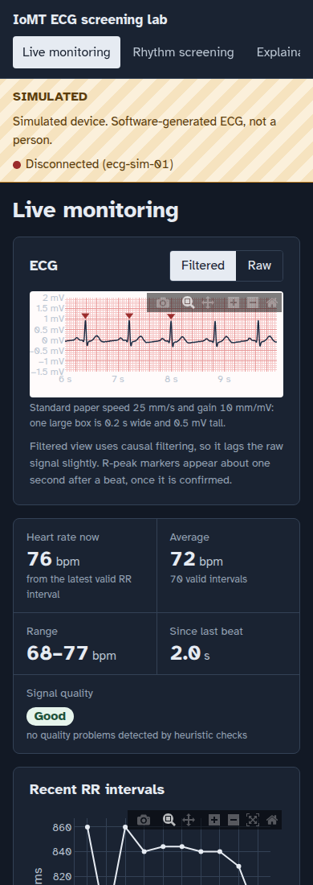
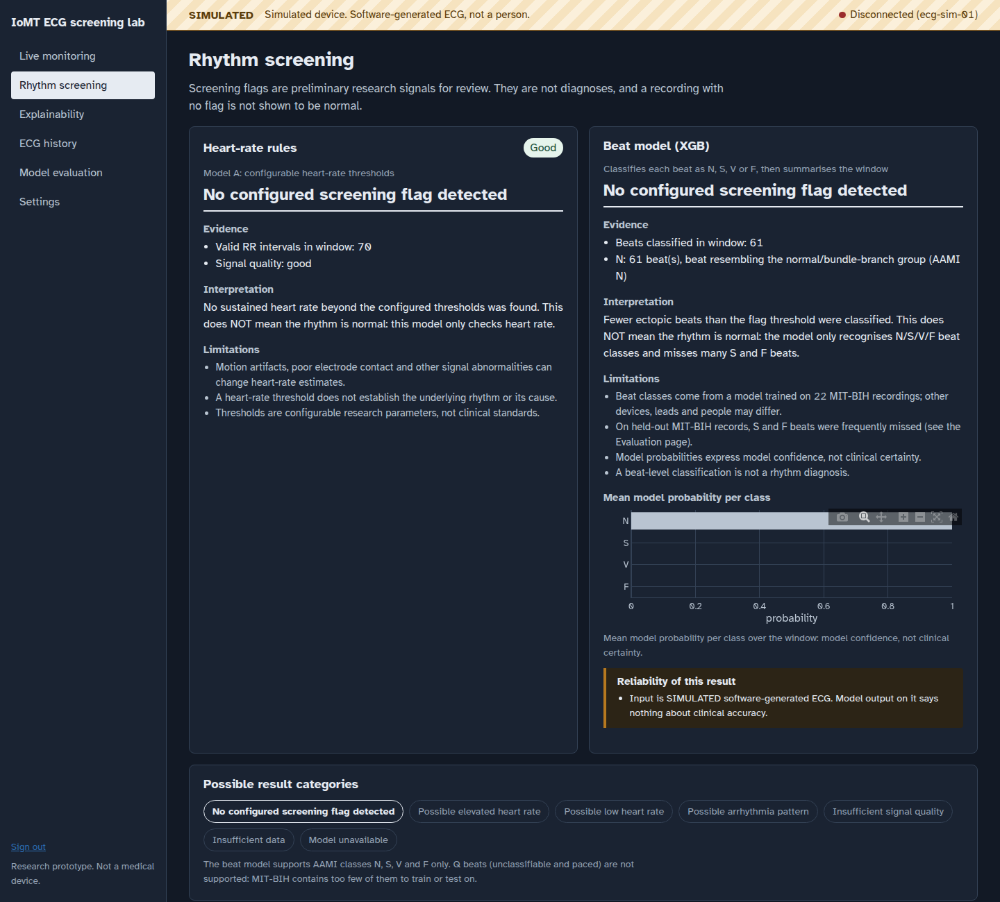
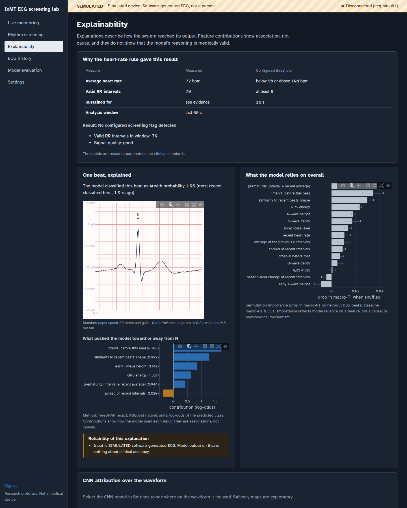
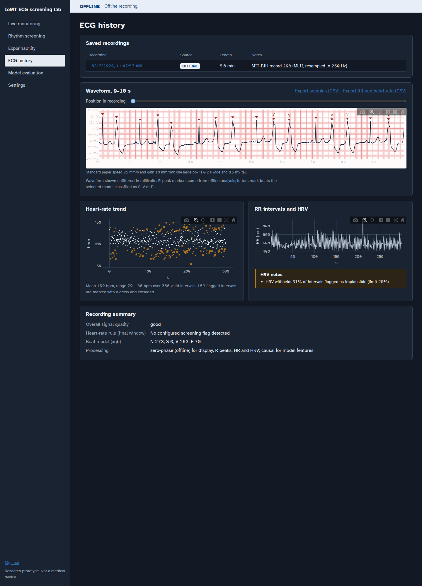
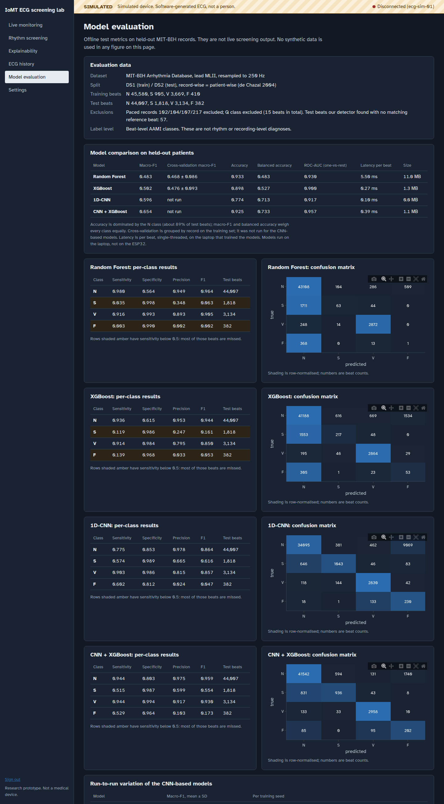
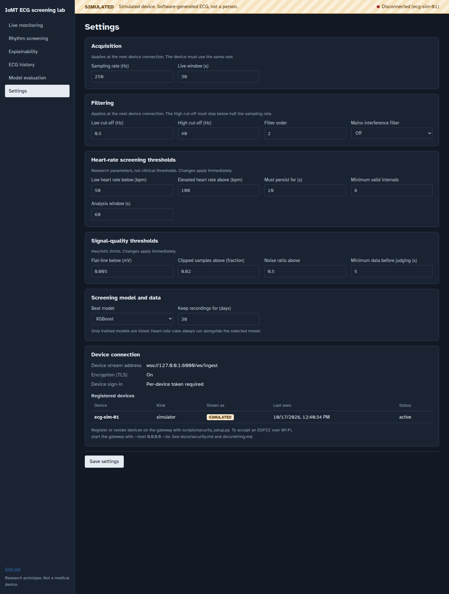

# Dashboard guide

The dashboard is the clinician-facing layer of the IoMT system. It runs in the browser
and talks only to the gateway, over HTTPS when the gateway is on the network. Every page
shows where its data comes from in the band across the top, so live hardware, simulated
data and offline recordings are never mixed up.

## Signing in

Enter the dashboard access token printed by `scripts/security_setup.py init`. Failed
attempts are limited (see [security.md](security.md)). The screen states whether the
connection is encrypted. Choose **Sign out** in the sidebar when you finish.

## Source band

The band at the top of every page states the data source and connection:

| Band | Meaning |
|---|---|
| **LIVE** (green) | Data from a registered hardware device |
| **SIMULATED** (hatched amber) | Software-generated ECG from the simulator. Never patient data. |
| **OFFLINE** (blue) | A saved recording, analysed after the fact |
| **Disconnected** | The source has not sent data in the last 5 seconds. The page keeps the last values it received. |

## Live monitoring

Filtered or raw ECG on calibrated paper (25 mm/s, 10 mm/mV), R-peak markers, heart rate
now and over the analysis window, signal quality, recent RR intervals, and connection
statistics: packets accepted, lost, duplicated, malformed and restarted. Lost samples are
counted, never filled in. **Save recording** stores the current contiguous segment.

On a phone, the ECG strip shows the last 4 seconds so the calibrated grid stays legible:

## Rhythm screening

Two independent results sit side by side:

- **Heart-rate rules:** flags a sustained heart rate above or below the configured
  thresholds, with the measured values and the duration.
- **Beat model:** the selected model's per-beat classes (N, S, V, F) summarised over the
  window, with mean probabilities and reliability warnings.

Result wording is deliberately limited. A window with no flag is shown as "no configured
screening flag detected", never as normal.

## Explainability

Shows why each result was reached: the measured values against the configured thresholds,
the per-beat feature contributions for the selected beat model, and global feature
importance on held-out data. For CNN models, the waveform is shaded where the network's
output was most sensitive. Saliency maps are exploratory only.

## ECG history

Saved recordings, each with its source. Opening one shows the waveform with R-peak
markers, a heart-rate trend, the RR tachogram and time-domain HRV. HRV is withheld with a
stated reason when the recording is too short or too many intervals are implausible.
Export samples (CSV) and RR and heart rate (CSV) are available from this page.

## Model evaluation

Offline test metrics for each model on the held-out MIT-BIH patients (DS2): macro-F1,
cross-validation where it was run, per-class sensitivity, specificity and precision,
confusion matrices, latency and model size. These figures come from the offline test
set. They are not live screening output, and the page says so. The full write-up,
including the seed-variation check for the CNN models, is in
[model_card.md](model_card.md).

## Settings

Acquisition, filter and screening thresholds, signal-quality limits, the selected beat
model and retention. Validation runs before anything is saved, and each setting says
whether it applies immediately or at the next device connection. The device connection
section shows the stream address, whether TLS is on, and the registered devices with
their sources and last-seen times. Devices are added and revoked on the gateway with
`scripts/security_setup.py`, never from the dashboard.
